# A Comparative Study of Linux File Systems

**Undergraduate Thesis (Trabajo Fin de Grado)** — B.Sc. in Informatics Engineering, Computer Engineering track
Universidad de Castilla-La Mancha (UCLM) · School of Computer Science Engineering of Albacete (ESIIAB)

<p align="center">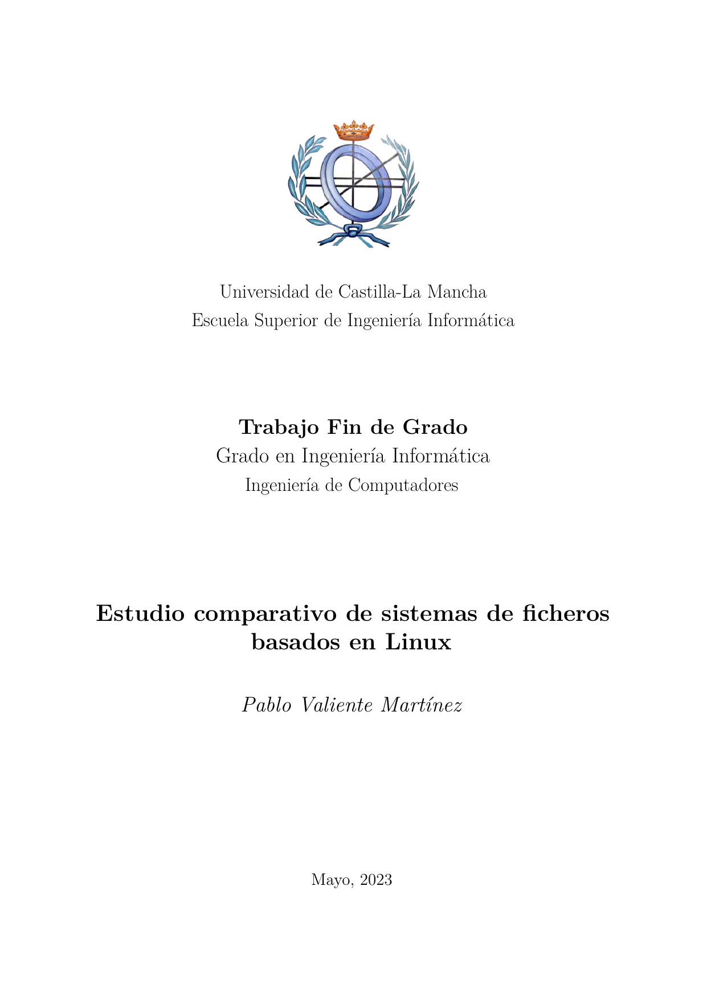</p>

| | |
|---|---|
| Author | Pablo Valiente Martínez |
| Advisors | Gabriel Cebrián Márquez, Valentín Valero Ruiz |
| Institution | Universidad de Castilla-La Mancha (UCLM) — ESIIAB |
| Degree | Grado en Ingeniería Informática, especialidad Ingeniería de Computadores |
| Related coursework | Sistemas Operativos II (Operating Systems II) |
| Grade | 10/10 |
| Date | May 2023 |
| Full document | [`thesis.pdf`](thesis.pdf) (94 pages, in Spanish) |

> The thesis itself (`thesis.pdf`) is written in Spanish (castellano), as required by the degree program. This README is written in English purely to make the repository accessible to a wider audience; it summarizes, but does not replace, the full document.

## Abstract

Choosing an appropriate file system is a determining factor in the efficient management of data on Linux systems. This is not a simple side-by-side benchmark: the thesis undertakes an in-depth architectural study of ext4, Btrfs, XFS and ZFS — how each one lays out data on disk, journals or copy-on-writes its metadata, and manages storage — and then critically reasons, case by case, about *why* each system performs the way it does under each workload, tracing every result back to a specific design decision (block sub-allocation, allocation groups, checksumming overhead, and so on). Seven read/write workloads were executed across file sizes ranging from 4 KB to 32 GB, and the resulting throughput data was used to derive practical, justified usage recommendations for each file system. The thesis was awarded a final grade of 10/10.

This work was carried out as the final undergraduate project (TFG) for the Computer Engineering degree at ESIIAB-UCLM, and builds directly on the Linux virtual file system and storage management concepts introduced in the *Sistemas Operativos II* (Operating Systems II) course, extending them into an empirical, benchmark-driven comparison of four production file systems.

## Contents

1. [Background](#1-background)
2. [Methodology](#2-methodology)
3. [Results](#3-results)
4. [Usage recommendations](#4-usage-recommendations)
5. [Limitations and future work](#5-limitations-and-future-work)
6. [Conclusion](#6-conclusion)

About this repository: [Structure](#repository-structure) · [License and contact](#license)

## 1. Background

| File system | Design focus |
|---|---|
| ext4 | Default Linux file system; classic journaling, mature and general-purpose |
| Btrfs | Copy-on-write, snapshots, block sub-allocation and built-in compression |
| XFS | High-throughput I/O, optimized for large files and volumes |
| ZFS | Integrated volume management, end-to-end data integrity and encryption |

The four file systems studied were introduced at different points over more than two decades of Linux development, which already hints at why they differ: ext4 and XFS descend from an era where journaling over a fixed block layout was the state of the art, while Btrfs and ZFS were designed later around copy-on-write and pooled storage.

<p align="center">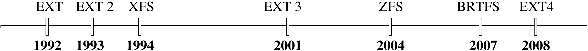</p>
<p align="center"><em>Figure 1. Timeline of the Linux file systems covered in this thesis, from ext (1992) to Btrfs (2007).</em></p>

**ext4** keeps the classic layout inherited from ext2/ext3: a fixed table of inodes and a journal bolted on top to make metadata updates crash-safe, rather than restructuring the on-disk format itself.

<p align="center">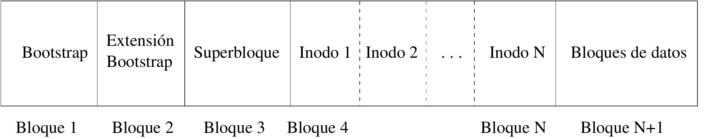</p>
<p align="center"><em>Figure 2. Internal structure of ext4: a fixed inode table alongside the data blocks.</em></p>

**Btrfs** replaces that fixed layout with copy-on-write B-trees rooted at the superblock; every metadata update writes a new block instead of overwriting in place, which is what later makes cheap snapshots and strong small-file/re-read performance possible.

<p align="center">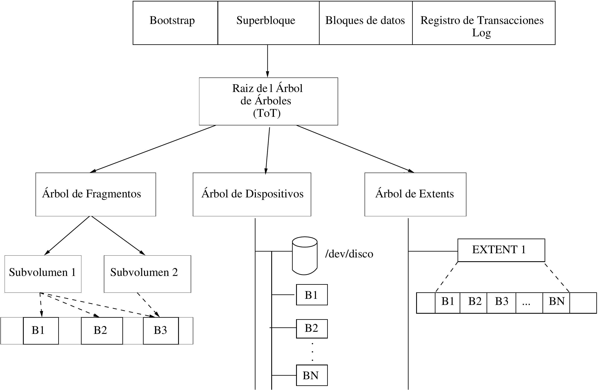</p>
<p align="center"><em>Figure 3. Btrfs superblock structure: the root of the copy-on-write B-tree layout.</em></p>

**XFS** organizes the disk into independent allocation groups, each with its own free-space and inode bookkeeping, so multiple threads can allocate space in parallel — the reason it pulls ahead specifically on large, high-throughput writes ([Section 3](#3-results)).

<p align="center">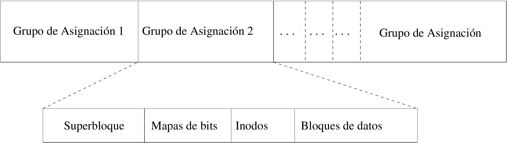</p>
<p align="center"><em>Figure 4. Logical organization of XFS into independent allocation groups.</em></p>

**ZFS** discards the traditional partition model entirely: physical disks are grouped into virtual devices (vdevs), pooled together, and file systems/block volumes are provisioned from that pool on demand. This buys flexibility and built-in checksumming, at the throughput cost visible throughout the results.

<p align="center">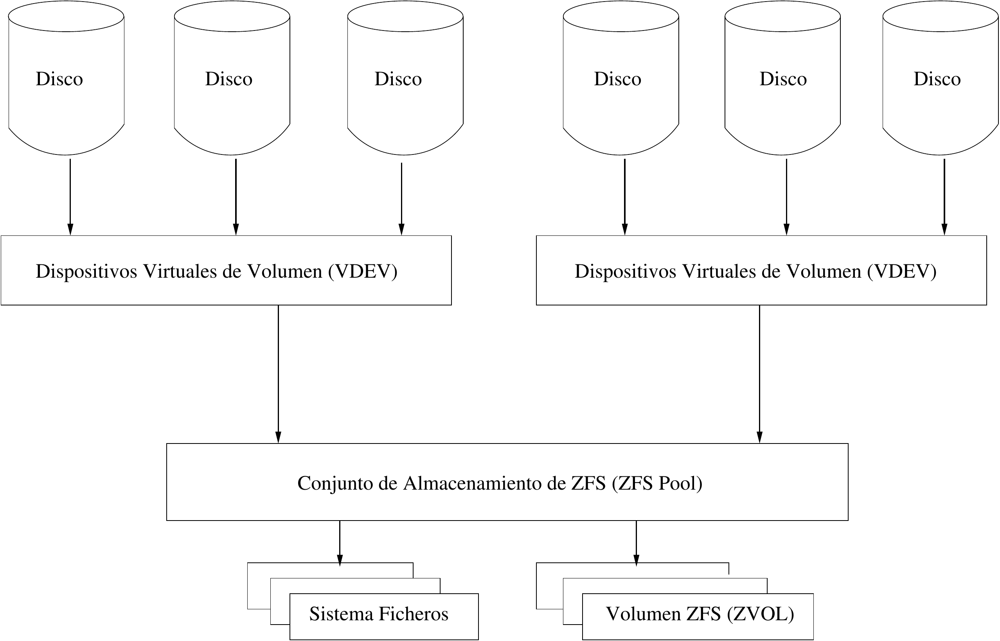</p>
<p align="center"><em>Figure 5. ZFS storage pool architecture: vdevs aggregated into a pool exposing file systems and zvols.</em></p>

Two mechanisms recur across these designs and are worth calling out explicitly, since they explain much of the performance gap measured later:

- **Journaling** (used by ext4 and XFS) logs every write twice — once to a sequential journal, once to its final location — trading some throughput for fast, safe crash recovery.
- **Copy-on-write** (used by Btrfs and ZFS) never overwrites live data in place, which makes an instantaneous snapshot as cheap as pointing to the existing tree instead of copying it.

<p align="center">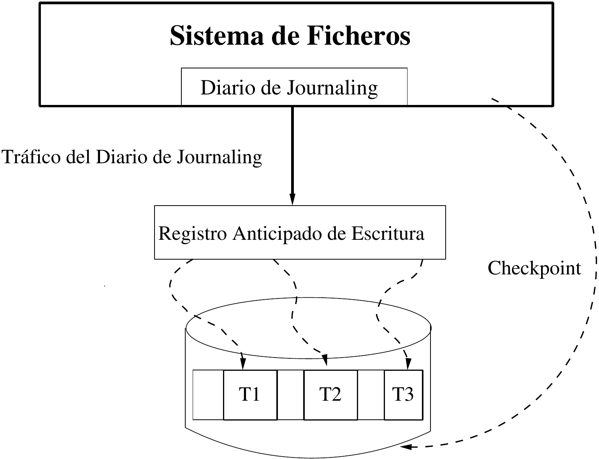</p>
<p align="center"><em>Figure 6. Journaling: writes are recorded to a write-ahead log before being checkpointed to their final location on disk.</em></p>

<p align="center">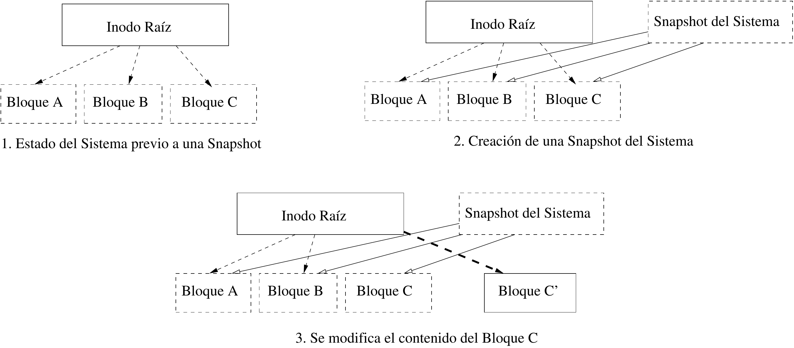</p>
<p align="center"><em>Figure 7. Copy-on-write snapshot creation: the snapshot references the existing tree instead of duplicating data.</em></p>

## 2. Methodology

Performance was measured with standard I/O benchmarking tools (`fio`, `iozone`) across seven workloads — sequential read, re-read, strided read, random read, sequential write, rewrite and random write — with file sizes ranging from 4 KB to 32 GB. Each file system was tested with its default configuration on the same hardware, without file-system-specific tuning.

The test environment used a single SSD without RAID pass-through, rather than the storage stack typical of a production server; this choice and its implications for the validity of the results are discussed in [Section 5](#5-limitations-and-future-work).

## 3. Results

### Summary (average throughput, MB/s)

| Workload | Best | ext4 | Btrfs | XFS | ZFS |
|---|---|---:|---:|---:|---:|
| Sequential read | Btrfs (+40% vs ext4) | 8.70 | 12.21 | 7.50 | 4.58 |
| Re-read | Btrfs (+45%) | 9.20 | 13.37 | 9.18 | 5.60 |
| Strided read | Btrfs (+41%) | 8.54 | 12.08 | 8.52 | 2.30 |
| Random read | Btrfs (+45%) | 7.61 | 11.07 | 7.64 | 3.41 |
| Sequential write | Btrfs (+39%)\* | 2.90 | 4.03 | 2.79 | 2.38 |
| Rewrite | Btrfs (+45%) | 9.20 | 13.37 | 9.18 | 5.60 |
| Random write | Btrfs (+29%) | 4.22 | 5.43 | 4.35 | 1.91 |

\* XFS reaches the highest peak throughput on large files (5.56 MB/s), owing to its allocation groups, even though its overall average is lower than Btrfs's.

Note: the source thesis reports identical figures for the re-read and rewrite workloads across all four file systems. These are reproduced here as they appear in the original document; this may be a duplicated table that the author should verify.

Btrfs leads six of the seven workloads, primarily due to block sub-allocation, delayed allocation and its caching strategy, with the largest margins on small files. ZFS is consistently the slowest of the four, a cost attributed to its integrity-checking and encryption overhead, though it shows the most stable behavior across repeated runs. XFS only overtakes Btrfs on sequential writes of large files.

### Detailed results by workload

Sequential read is the workload where the choice of file system matters most for small files: Btrfs pulls ahead almost immediately and stays there, while ext4 and XFS need much larger files to close the gap.

<p align="center">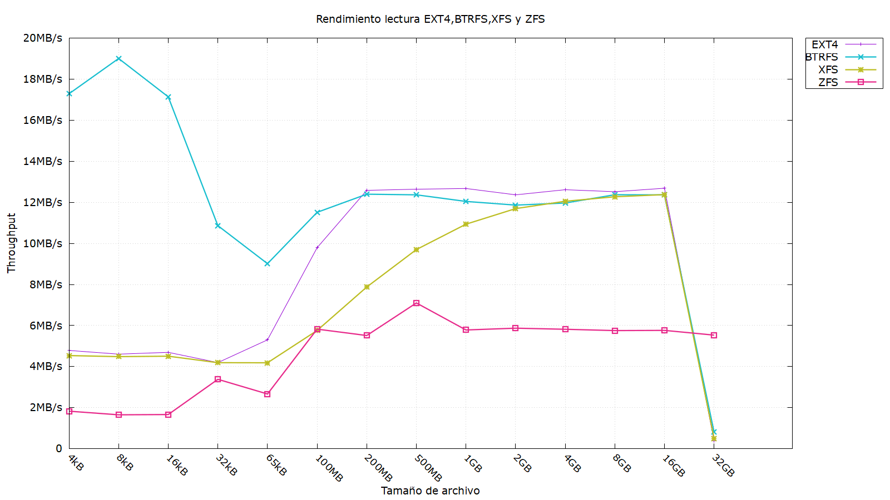</p>
<p align="center"><em>Figure 8. Sequential read throughput vs. file size. Btrfs: 12.21 MB/s avg. (+40% vs ext4, +63% vs XFS); all four converge around 1–4 MB files, then collapse together once files exceed available RAM cache.</em></p>

Re-reading a file benefits from the page cache regardless of file system, but Btrfs's block sub-allocation still gives it the largest margin of any workload tested.

<p align="center">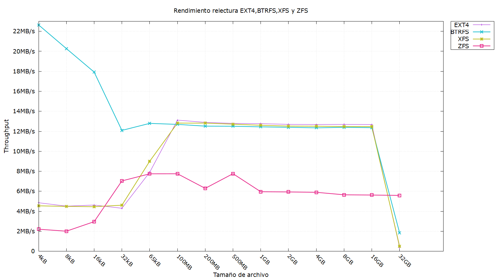</p>
<p align="center"><em>Figure 9. Re-read throughput vs. file size. Btrfs: 13.37 MB/s avg. (+45% vs ext4/XFS); see the note above the table regarding this dataset's overlap with the rewrite results.</em></p>

Strided (non-contiguous) access is where ZFS suffers the most of the seven workloads — its checksum and integrity bookkeeping compounds badly once reads stop being sequential.

<p align="center">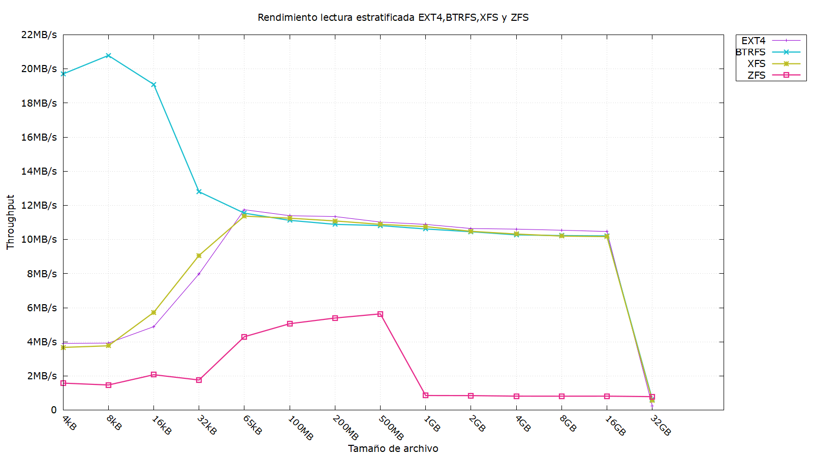</p>
<p align="center"><em>Figure 10. Strided read throughput vs. file size. ZFS drops to 2.30 MB/s avg., its worst result across all seven workloads (−81% vs Btrfs).</em></p>

Random read shows the same Btrfs advantage as sequential read, but the crossover point where all systems degrade happens earlier — at 32 kB files rather than in the low megabytes.

<p align="center">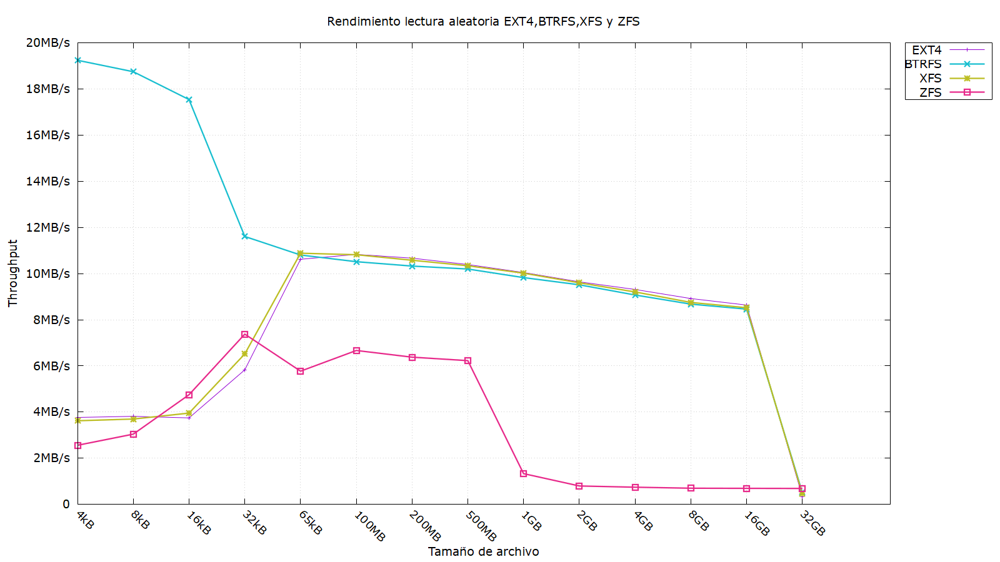</p>
<p align="center"><em>Figure 11. Random read throughput vs. file size. Btrfs: 11.07 MB/s avg. (+45% vs ext4/XFS).</em></p>

Sequential write is the one workload where the "best" system depends on file size: Btrfs wins on average because of small-file performance, but XFS's allocation groups let it overtake everyone once files get large.

<p align="center">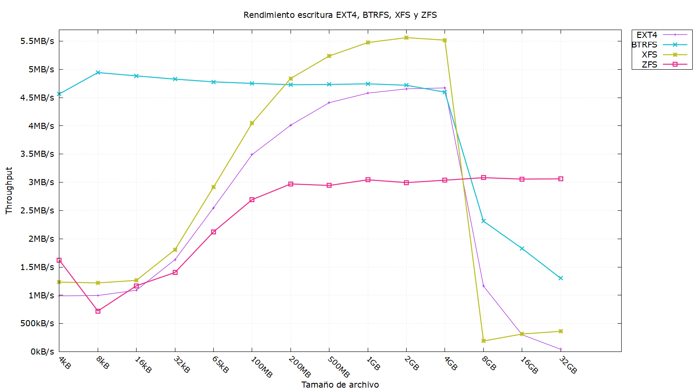</p>
<p align="center"><em>Figure 12. Sequential write throughput vs. file size. Btrfs: 4.03 MB/s avg., but XFS reaches the highest single peak (5.56 MB/s) on the largest files.</em></p>

Rewriting an existing file is cheaper than a first write for every file system, since no new block allocation table has to be built — Btrfs again leads by the same margin as re-read.

<p align="center">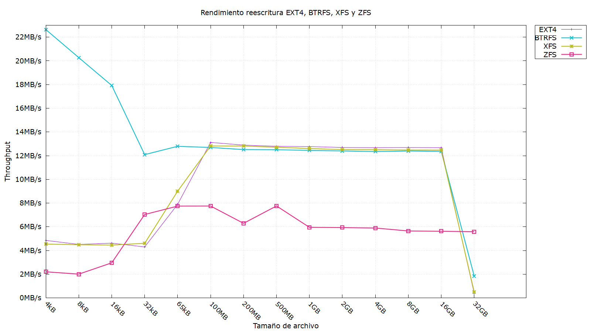</p>
<p align="center"><em>Figure 13. Rewrite throughput vs. file size. Btrfs: 13.37 MB/s avg. (+45% vs ext4/XFS).</em></p>

Random write is the most demanding workload for ZFS, which falls to less than half of ext4's throughput — the clearest single data point behind the "ZFS trades speed for integrity" conclusion.

<p align="center">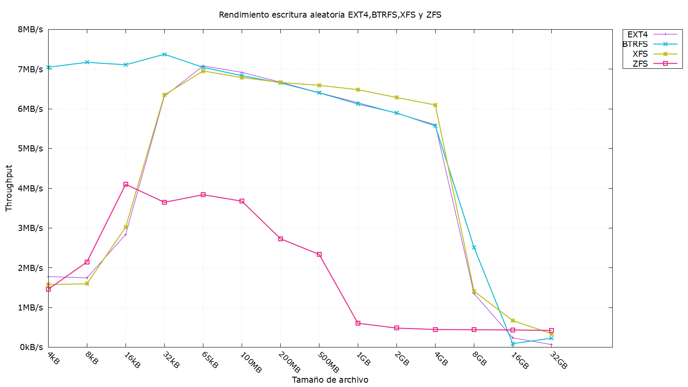</p>
<p align="center"><em>Figure 14. Random write throughput vs. file size. Btrfs: 5.43 MB/s avg. (+29% vs ext4); ZFS: 1.91 MB/s avg., its second-worst result overall.</em></p>

Raw data for each workload is available as `.dat` files in [`results/`](results/).

## 4. Usage recommendations

| File system | Recommended for | Rationale |
|---|---|---|
| Btrfs | Databases, source code repositories | Strong performance on small files and re-read-heavy workloads; block sub-allocation |
| XFS | Virtual machine image stores, video storage | Superior sequential/random write throughput on large files |
| ext4 | File servers, general-purpose workstations | Consistent, unremarkable performance across the board; a reliable default |
| ZFS | Backup systems, storage of critical data | Prioritizes data integrity and security (checksums, encryption) over raw throughput |

## 5. Limitations and future work

The following limitations are acknowledged by the author in the thesis's own conclusions:

- ZFS showed high variance between repeated runs of the same test; more repetitions and larger file sizes (64–128 GB) are recommended to establish reliable figures.
- The test environment used a single SSD without RAID pass-through, rather than the storage stack typical of a production server; this may have introduced metadata overhead not representative of real-world Btrfs/ZFS deployments.
- NVMe drives were not tested, nor were per-application tuning configurations — only each file system's default settings were evaluated.
- It remains open whether ZFS's lower throughput is inherent to the file system or specific to its Linux implementation (OpenZFS), since no other platform was tested for comparison.
- Suggested future work includes: profiling ZFS to localize the performance gap, evaluating `bcache`/SSD caching, testing Btrfs's LZO compression at larger scale, exercising RAID and deduplication support, and measuring behavior under virtualization and over the network.

## 6. Conclusion

The thesis met its stated objectives: a structured study of four Linux file systems' internal architecture, a controlled benchmarking environment built specifically for this comparison, and a set of evidence-based usage guidelines derived from the resulting data. Btrfs proved the most efficient choice for small-file and read-heavy workloads, XFS for large sequential writes, ext4 for general-purpose stability, and ZFS for integrity-critical storage at the cost of raw throughput.

The author also reflects on the study's broader relevance: more efficient file systems translate directly into lower hardware and energy requirements for data centers, a small per-server gain that compounds meaningfully at scale — a point the thesis raises explicitly when discussing its ethical and social implications.

---

## Repository structure

```
.
├── thesis.tex               Main LaTeX source (single entry point)
├── include/                 Document options, packages and color scheme
├── chapters/                One file per chapter (ch01_introduction.tex … ch10_conclusions_future_work.tex)
├── elements/                Title page and front matter (title_page.tex, front_matter.tex)
├── bib/ref.bib              Bibliography
├── figs/                    Institutional logos
├── figures/                 Diagrams referenced by the chapters (ext4, Btrfs, XFS, ZFS, journaling, snapshots, timeline...)
├── results/                 Benchmark data (.dat) and result plots
└── docs/figures/            PNG renders of the thesis's own figures, used only in this README
```

Nothing is left loose at the repository root besides the main `.tex`/`.pdf`, `README.md`, `Makefile` and `.gitignore`; every figure and data file lives under one of the folders above. All folder and file names use English words, independently of the thesis text itself (which is in Spanish, see the note at the top of this document).

External reference documentation is also included as-is under `figures/`: `ext4.pdf`, `btrfs_btree.pdf`, `xfs.pdf`, `zfs.pdf`.

## License

The content of this repository (thesis text, figures, benchmark data) is released under [Creative Commons Attribution 4.0 International (CC BY 4.0)](https://creativecommons.org/licenses/by/4.0/): free to share and adapt for any purpose, including commercially, as long as appropriate credit is given to the author.

## Contact

Pablo Valiente Martínez — valiente.pablo@proton.me

---
*Last updated: September 2026*
